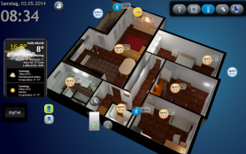
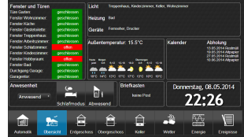
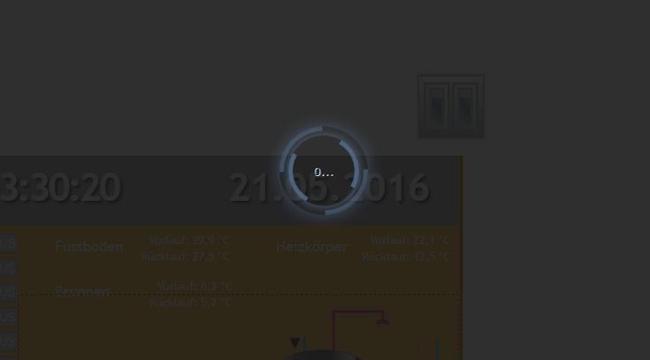

# Visualisation

  [](https://www.npmjs.com/package/iobroker.vis)
[](https://www.npmjs.com/package/iobroker.vis)

[](https://nodei.co/npm/iobroker.vis/)

WEB visualization for ioBroker platform.

***The development of this version is stopped. Please migrate your projects to vis-2.***

## License requirements
The adapter is free for all kinds of usage.

## Installation & Documentation




[Online Demos](https://iobroker.click/)

## Bindings of objects
Normally, most of the widgets have ObjectID attribute and this attribute can be bound with some value of object ID.
But there is another option for how to bind *any* attribute of widget to some ObjectID. 

Just write into attribute `{object.id}` and it will be bound (not in edit mode) to this object's value. 
If you use the special format, you can even make some simple operations with it, e.g., multiplying or formatting.
Patten has the following format:

```
{objectID;operation1;operation2;...}
```

The following operations are supported:

- `\*` - multiplying. Argument must be in brackets, like "*(4)". In this sample, we multiply the value with 4.
- `\+` - add. Argument must be in brackets, like "+(4.5)". In this sample we add to value 4.5.
- `\-` - subtract. Argument must be in brackets, like "-(-674.5)". In this sample we subtract from value -674.5.
- `/` - dividing. Argument must be in brackets, like "/(0.5)". In this sample, we divide the value by 0.5.
- `%` - modulo. Argument must be in brackets, like "%(5)". In this sample, we take modulo of 5.
- `round` - round the value.
- `round(N)` - round the value with N places after point, e.g., 34.678;round(1) => 34.7
- `hex` - convert value to hexadecimal value. All letters are lower cased.
- `hex2` - convert value to hexadecimal value. All letters are lower cased. If value less 16, so the leading zero will be added.
- `HEX` - same as hex, but upper-cased.
- `HEX2` - same as hex2, but upper-cased.
- `date` - format date according to given format. Format is the same as in [iobroker.javascript](https://github.com/iobroker/iobroker.javascript/blob/master/README.md#formatdate)
- `min(N)` - if value is less than N, take the N, else value
- `max(M)` - if value is greater than M, take the M, else value
- `sqrt` - square root
- `pow(n)` - power of N.
- `pow` - power of 2.
- `floor` - Math.floor
- `ceil` - Math.ceil
- `json` - operation for getting json or object property. E.g., `{id;json(common.name.en)}`
- `random(R)` - Math.random() * R, or just Math.random() if no argument
- `formatValue(decimals)` - format value according to system settings and use decimals
- `date(format)` - format value as date. The format is like: `YYYY-MM-DD hh:mm:ss.sss`
- `momentDate(format, useTodayOrYesterday)` - format value as date using Moment.js. [Approved formats must be entered according to the moment.js library](https://momentjs.com/docs/#/displaying/format/). With `useTodayOrYesterday=true` the momentjs format `ddd`/`dddd` are overwritten with today / yesterday
- `array(element1,element2[,element3,element4])` - returns the element of index. e.g.: `{id.ack;array(ack is false,ack is true)}`

You can use this pattern in any text, like

```
My calculations with {objectID1;operation1;operation2;...} are {objectID2;operation3;operation4;...}
```

or color calculations:

```
#{objectRed;/(100);*(255);HEX2}{objectGreen;HEX2}{objectBlue;HEX2}
```

To show timestamp of object write `.ts` or `.lc` (for last change) at the end of object id, e.g.:

```
Last change: {objectRed.lc;date(hh:mm)}
```

There is another possibility to write the pattern:

```
Hypotenuse of {height} and {width} = {h:height;w:width;Math.max(20, Math.sqrt(h*h + w*w))}
```

`{h:height;w:width;h*w}` will be interpreted as function:

```
value = (function () {
    var h = "10";
    var w = "20";
    return Math.max(20, Math.sqrt(h*h + w*w));
})();
```

You can use *any* javascript functions. Arguments must be defined with ':', if not, it will be interpreted as formula.

Take care about types. All of them are defined as strings. To be sure, that value will be treated as number use parseFloat function.

```
Hypotenuse of {height} and {width} = {h:height;w:width;Math.max(20, Math.sqrt(Math.pow(parseFloat(h), 2) + Math.pow(parseFloat(w), 2)))}
```

### Special bindings
There are a number of different internal bindings to provide additional information in views:
* `username` - shows logged-in user
* `view` - name of actual view
* `wname` - widget name
* `widget` - is an object with all data of widget. Can be used only in JS part, like `{a:a;widget.data.name}`
* `wid` - name of actual widget
* `language` - can be `de`, `en` or `ru`.
* `instance` - browser instance
* `login` - if login required or not (e.g., to show/hide logout button)
* `local_*` - if state name is started from `local_` it will not be reported to ioBroker but will update all widgets, that depends on this state. (Local variable for current browser session)

Note: to use ":" in calculations (e.g., in string formula) use "::" instead.

**Remember**, that style definitions will be interpreted as bindings, so use `{{style: value}}` or just

```
{
	style: value
}
```

for that.

## Filters
To visualize on the one view the whole number of widgets, you can use filters to reduce the number of widgets simultaneously shown on the view.
 
Every widget has a field `filter`. If you set it to some value, e.g. `light`, so you can use other widget `(bars - filters, filter - dropdown)` to control which filter is actually active.

## Control interface
Vis creates 3 variables:

- `control.instance` - Here the browser instance should be written or `FFFFFFFF` if every browser must be controlled.
- `control.data`     - Parameter for command. See specific command description.
- `control.command`  - Command name. Write this variable triggers the command. That means before command will be written, the "instance" and "data" must be prepared with data.

Commands:

* `alert` - show an alert window in the vis. "control.data" has the following format "message;title;jquery-icon". Title and jquery-icon are optional. Icon names can be found [here](http://jqueryui.com/themeroller/). To show icon "ui-icon-info" write ```Message;;info```.
* `changeView` - switch to desired view. "control.data" must have the name of view. You can specify the project name too as "project/view". The default project is "main".
* `refresh` - reload the vis, for instance after a project is changed to reload on all browsers.
* `reload` - same as refresh.
* `dialog` - Show dialog window. Dialog must exist on view. One of:

    - `static    - HTML    - Dialog`,
    - `static    - Icon    - Dialog`,
    - `container - HTML    - view in jqui Dialog`,
    - `container - ext cmd - view in jqui Dialog`,
    - `container - Icon    - view in jqui Dialog`,
    - `container - Button  - view in jqui Dialog`.

    `control.data` must have id of dialog widget, e.g. `w00056`.
* `dialogClose`
* `popup` - opens a new browser window. Link must be specified in `control.data`, e.g., http://google.com
* `playSound` - play sound file. The link to file is specified in `control.data`, e.g., http://www.modular-planet.de/fx/marsians/Marsiansrev.mp3.
  You can upload your own file in vis and let it play as for instance `/vis.0/main/img/myFile.mp3`.

If the user changes the view or at start, the variables will be filled by the vis with

- `control.instance`: browser instance and `ack=true`
- `control.data`: project and view name in form `project/view`, e.g. `main/view` (and `ack=true`)
- `control.command`: `changedView` and `ack=true`

You can write the JSON string or Object into `control.command` as `{instance: 'AABBCCDD', command: 'cmd', data: 'ddd'}`. In this case, the instance and data will be taken from JSON object.

Example for javascript adapter:

```
setState('vis.0.control.command', {"instance": "*", "command": "refresh", "data": ""});
```

## Default view
You can define for every view the desired resolution (Menu=>Tools=>Resolution). This is only the visual border in edit mode to show you the screen size on some specific device. In real time mode it will not be visible and all widgets outside of border will be visible.  

Additionally, you can define if this view must be used as default for this resolution. 

So every time the `index.html` (without `#viewName`) is called, the best suitable for this resolution view will be opened.
If only one view has *"Default"* flag, so this view will be opened independently of screen resolution or orientation.      

E.g., you can create two views "Landscape-Mobile" and "Portrait-Mobile" and these two views will be switched automatically when you change the orientation or screen size.

There is a helper widget "basic - Screen Resolution" that shows actual screen resolution and best suitable default view for this resolution. 

## Web components
Adapters can bring [ioBroker web components](https://github.com/ioBroker/web-components): custom elements that vis, vis-2, admin and other hosts show alike. An adapter lists them in `common.webComponents` of its `io-package.json`.

vis finds the web components of all installed adapters when the editor or the runtime starts (no restart of vis is required after the installation of such an adapter) and shows them as widgets of the widget set "webcomponents":
- The settings of a component are the attributes of the widget, with their labels, defaults, options and the conditions "hidden" and "disabled".
- The group "Web component" has the theme of the component: "auto" takes dark if the text color of the widget is light. Optionally, a primary color can be set.
- The runtime loads the components only if a view shows one. A component that edits a value (`editsValue`) is not offered, as vis stores no values.
- The event `iob-navigate` of a component opens the view of that name.

A browser without ES modules and custom elements shows a hint instead of the component. The views and all other widgets work as before.

## Settings
### Reload if sleep longer than
There is a rule that after some disconnection period, the whole VIS page will be reloaded to synchronize the project.
You can configure it in the menu "Settings...". If you set an interval to "never" so the page will never be reloaded.

### Reconnect interval
Set the interval between the connection attempts if disconnected. If you set 2 seconds, it will try to establish the connection every 2 seconds.

### Dark reconnect screen
Sometimes (in the night) it is required to have a dark loading screen. With this option, you can set it.

Notice that these settings are valid only for reconnection and not for the first connection.



<!--
    Placeholder for the next version (at the beginning of the line):
    ### **WORK IN PROGRESS**
-->
## Changelog
### **WORK IN PROGRESS**
* (bluefox) Added support of ioBroker web components (`@iobroker/web-components`): the components of the installed adapters are shown as widgets of the set "webcomponents"

### 1.6.0 (2026-11-19)
* (bluefox) Modern look of the editor for the themes "Light" and "Dark" (only the editor, the runtime and the views are not changed). "Dark-Hive" and "redmond" keep the classic look.
* (bluefox) Modern loading screen in the editor for the themes "Light" and "Dark"
* (bluefox) Fixed the error "Unexpected non-whitespace character after JSON" if the browser instance ID was stored as plain text
* (bluefox) Fixed changing of the browser instance ID in the editor
* (bluefox) The pages with the installed widget sets are generated only at the start of the instance and not by "npm install" anymore
* (bluefox) Backend migrated to TypeScript
* (bluefox) Fixed: the settings "always" and "dependencies" of widget sets found outside of the ioBroker "node_modules" directory were ignored

### 1.5.7 (2026-10-04)
* (bluefox) Global `let`/`const` variables of widget sets are visible again if the widget sets are loaded dynamically (e.g. via cloud).
* (ioBroker-Bot) Adapter requires js-controller >= 6.0.11 now.
* (bluefox) Removed usage of `storage` and uses localStorage instead.

### 1.5.5 (2024-04-12)
* (bluefox) Corrected small warning

### 1.5.4 (2023-11-29)
* (agav99) added the new binding operation for getting property of JSON or object
* (agav99) Checked the initialization of the `local_` variables
* (agav99) fixed subscribeOidAtRuntime
* (stephanritscher) Added dynamic web manifest
* (agav99) Optimization for basic-view in widget8
* (oweitman) Changed binding regex to accept umlauts
* (mcm1957) Corrected first installation of vis

### 1.5.1 (2023-11-06)
* (bluefox) Changed License: it is now MIT, and the license check was removed

### 1.4.16 (2023-01-27)
* (bluefox) Corrected connection with "only port" URLs

## License
The MIT License (MIT)

Copyright (c) 2013-2026 Denis Haev <dogafox@gmail.com>,
Copyright (c) 2013      hobbyquaker

Permission is hereby granted, free of charge, to any person obtaining a copy
of this software and associated documentation files (the "Software"), to deal
in the Software without restriction, including without limitation the rights
to use, copy, modify, merge, publish, distribute, sublicense, and/or sell
copies of the Software, and to permit persons to whom the Software is
furnished to do so, subject to the following conditions:

The above copyright notice and this permission notice shall be included in
all copies or substantial portions of the Software.

THE SOFTWARE IS PROVIDED "AS IS", WITHOUT WARRANTY OF ANY KIND, EXPRESS OR
IMPLIED, INCLUDING BUT NOT LIMITED TO THE WARRANTIES OF MERCHANTABILITY,
FITNESS FOR A PARTICULAR PURPOSE AND NONINFRINGEMENT. IN NO EVENT SHALL THE
AUTHORS OR COPYRIGHT HOLDERS BE LIABLE FOR ANY CLAIM, DAMAGES OR OTHER
LIABILITY, WHETHER IN AN ACTION OF CONTRACT, TORT OR OTHERWISE, ARISING FROM,
OUT OF OR IN CONNECTION WITH THE SOFTWARE OR THE USE OR OTHER DEALINGS IN
THE SOFTWARE.
